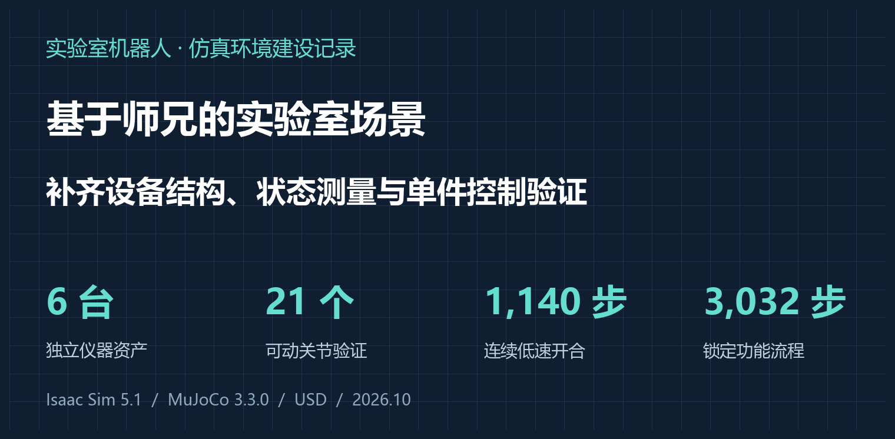
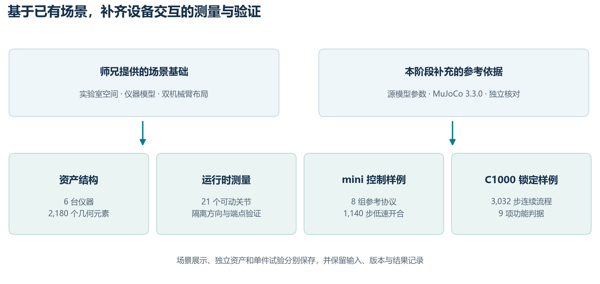
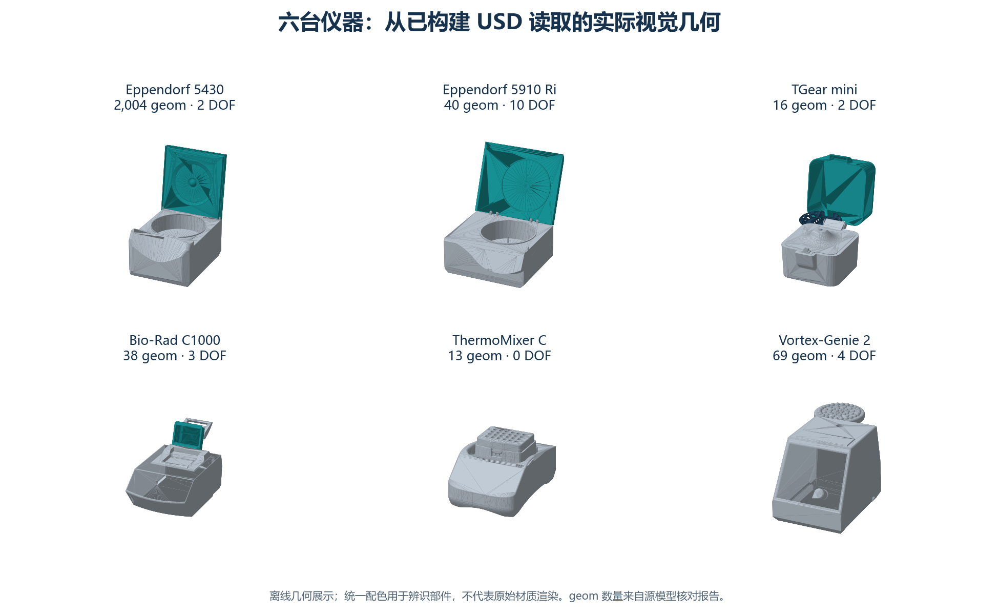
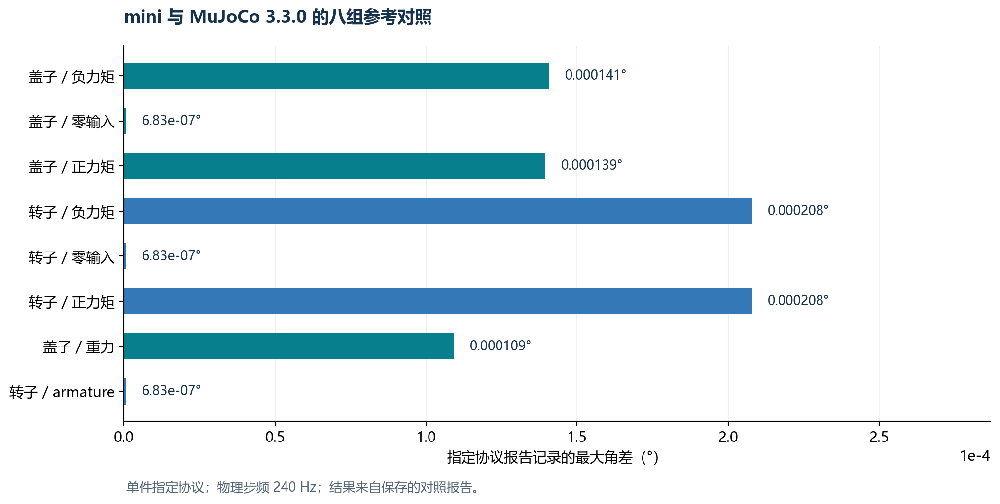
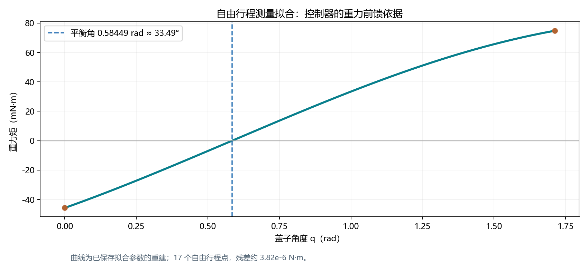
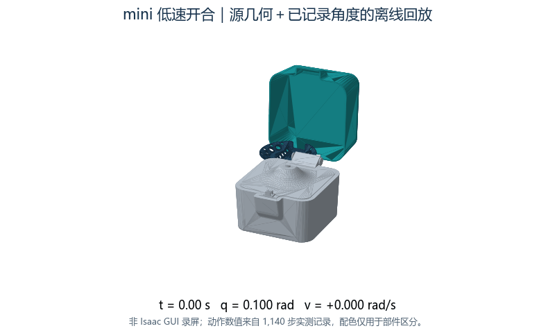
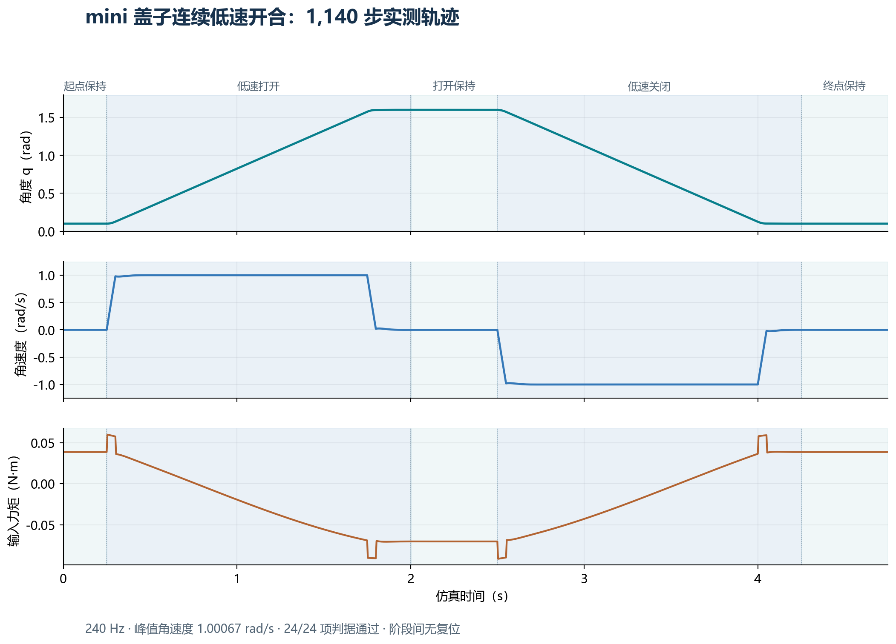

# Isaac Sim 实验室场景搭建记录：接着师兄的场景做设备交互



上一篇写的是 AutoBio 的训练和评测。这段时间换了个方向，主要在搭实验室仿真环境。

场景是接着师兄的工作做的，实验室、台面、设备模型和双机械臂布局已经有了。我主要往下做仪器这一块：整理模型结构，把关节状态读出来，再挑几台设备做控制和对照测试。这里把做完的东西记一下，组会也方便讲。

## 0. 先放结果

目前整理了六台仪器，核对了 2,180 个源几何元素，21 个可动关节都做了单独测试。

后面主要测了两个设备。一个是 mini 离心机，做了八组 MuJoCo 3.3.0 参考对照，还做了盖子慢速打开、保持、关闭的连续控制。另一个是 C1000 热循环仪，做了解锁、开盖、关盖、再锁上的连续功能测试。

| 做了什么 | 结果 |
| --- | --- |
| 场景资源整理 | 原场景材质引用保留，双 UR5e 和夹爪资源放到本地 |
| 六台仪器结构整理 | 核对 2,180 个源几何元素、21 个可动关节 |
| 关节单独测试 | 21/21 通过，测试条件为零重力、禁接触、测试驱动 |
| mini 参考对照 | 八组指定协议通过，报告最大角差约 0.000208° |
| mini 低速开合 | 连续 1,140 步，峰值角速度约 1 rad/s，24 项检查通过 |
| C1000 锁盖测试 | 连续 3,032 步，9 项功能检查通过，三次记录一致 |

下面按实际做的顺序展开。

## 1. 接着师兄的场景往下做

师兄已经把实验室的大体环境和双机械臂布局搭好了，所以我没有重新做一套场景。这段时间主要补设备结构、状态读取和控制测试。

场景这边，先把模型引用关系理了一遍，机械臂和夹爪用到的官方资源缓存到本地，保留原来的材质引用。主场景用来看整体布局，设备另外存成独立 USD，测试时只加载需要的那一台。

单独拆出来的好处比较直接：测盖子就只看盖子和底座的关系，测转子就只看转子输入和角度变化，记录也容易对上。



这轮用的是 Windows 下的 Isaac Sim 5.1，显卡为 RTX 4060 Laptop GPU。参考对照使用 MuJoCo 3.3.0。mini 的低速开合测试在 CPU 物理下运行，步频 240 Hz，重力为 9.81 m/s²。

## 2. 六台仪器，先把结构对齐

### 2.1 这次整理了哪些设备

包括三台离心机、一台热循环仪、一台恒温混匀仪和一台涡旋混匀仪。



| 设备 | 源几何元素数 | 可动关节数 |
| --- | --- | --- |
| Eppendorf 5430 | 2,004 | 2 |
| Eppendorf 5910 Ri | 40 | 10 |
| Tiangen TGear mini | 16 | 2 |
| Bio-Rad C1000 | 38 | 3 |
| Eppendorf ThermoMixer C | 13 | 0 |
| Vortex-Genie 2 | 69 | 4 |
| 合计 | 2,180 | 21 |

表里的几何元素按源模型统计，不等于肉眼看到的零件数。ThermoMixer C 这份源结构里没有可动关节，所以这里只计入模型整理。

### 2.2 具体对了什么

主要是几何位置、刚体关系、关节轴、关节锚点，还有质量、质心和惯量。

旋转和平移关节分别写成 USD 的 `PhysicsRevoluteJoint`、`PhysicsPrismaticJoint`。质量参数通过 `MassAPI` 写入，驱动参数通过 `DriveAPI` 写入。

坐标检查时，把源模型和 USD 中的数据都换到世界坐标，再比较位置和方向。这样能把父级变换也算进去。独立检查得到的最大锚点偏差约 `7.91e-6 mm`，最大轴向向量误差约 `3.59e-8`。这里比较的是模型转换前后的数值，不是实物测量精度。

构建脚本和检查脚本分开存：

```text
scripts/mjcf_instrument_to_usd_v5.py    构建设备
scripts/check_v5_independent.py        读取产物并核对
assets/instruments5/                  六台仪器的输出
```

后面改模型时，可以再跑一遍检查，不用只靠看外观判断。

## 3. 把关节状态读出来

设备能不能按要求动，得有读数。现在接通了两类接口：

- `RigidBodyView.get_transforms()`：读取刚体世界位置和四元数。
- `ArticulationView`：读取关节位置和速度。

这里有一个需要注意的地方：盖子绕铰链转，刚体原点可能就在铰链轴上。这种情况下，盖子转了，原点位置也可以不变。所以旋转动作要看姿态或关节角度，不能只看位置。

21 个可动关节分别做了方向和范围测试，同时检查连接处的约束偏差。这组测试使用零重力、禁接触和测试驱动，主要检查关节结构、驱动和读数能不能对上。21 个关节都通过了这一层检查，汇总在 `v5_runtime_acceptance_20261019.json`。

有了这一步，后面测设备时，就能直接记录角度、速度和输入，画出完整的响应过程。

## 4. mini 离心机：先做参考对照

mini 结构比较简单，主要是底座、盖子和转子，适合先拿来测。

### 4.1 八组参考协议

对照使用 MuJoCo 3.3.0 的同源模型数据，覆盖盖子和转子的正向、反向、零输入，以及重力和指定 armature 条件。每组都记下初态、输入和步频。

八组指定协议通过，报告中的最大角差约 `0.000208°`。各组结果放在下面。



这个结果对应的是这八组单件协议。这里先把对照条件和结果存好，后面继续做逐步轨迹比较时可以沿用。

### 4.2 盖子的重力矩

要让盖子慢慢开、慢慢关，需要知道不同角度下的重力矩。我取自由行程内的 17 个点，拟合了下面这个式子：

```text
τg(q) = A sin(q) + B cos(q) + C

A =  0.0690607337 N·m
B = −0.0456426667 N·m
C = −0.0000405544 N·m
```

拟合残差约 `3.82e-6 N·m`，平衡角约 `0.58449 rad`，也就是 `33.49°`。



从曲线上能看到，平衡角两边的重力矩方向不同。控制器在盖子悬空保持时，需要持续出力抵消重力。后面保持段记录下来的力矩，也可以跟这里对一下。

## 5. mini 盖子低速开合

### 5.1 跑了什么动作

这一轮连续跑五段：起点保持、慢速打开、打开后保持、慢速关闭、终点保持。起终点选在 `0.10 rad` 和 `1.60 rad`，都留在限位内部。

步频 240 Hz，共 1,140 步，约 4.75 秒，中间不重置状态。

下面的动图是用 USD 几何和记录下来的关节角度重建的，方便看动作。它是离线回放，不是 Isaac GUI 录屏。



### 5.2 控制方法

参考轨迹用梯形速度规划，给出目标角度、速度和加速度。输入力矩由惯性前馈、重力补偿、位置反馈和速度反馈组成：

```text
τ = I·a_ref − τg(q)
    + Kp·(q_ref − q) + Kd·(v_ref − v)

力矩限制：±0.25 N·m
```

这一轮的参数为：

| 参数 | 数值 |
| --- | --- |
| 盖子惯量 I | 约 1.05504e-3 kg·m² |
| 设计带宽 ω | 30 rad/s |
| 阻尼比 ζ | 0.7 |
| Kp = Iω² | 约 0.94953 N·m/rad |
| Kd = 2Iζω | 约 0.04431 N·m·s/rad |
| 设计速度 | 1 rad/s |
| 设计加速度 | 20 rad/s² |

保持段给常值位置参考，目标速度和加速度为零，反馈继续工作。规划器设了 `1e-6 rad` 的位置死区，小于这个量就按保持处理。

### 5.3 实际曲线



上面依次是角度、角速度和输入力矩。打开和关闭时速度方向相反，保持时速度接近零。盖子打开后悬空保持，仍然需要补偿力矩。

| 检查项 | 结果 |
| --- | --- |
| 峰值角速度 | 1.00067 rad/s |
| 最大跟踪误差 | 1.667 mrad，约 0.096° |
| 力矩饱和步数 | 0 |
| 距限位最小距离 | 约 0.10 rad |
| 判据 | 24/24 通过 |

每一步都存了推进前后的角度和速度，以及真正写入接口的力矩。步号从 0 到 1139 连续，前一步的后状态和下一步的前状态一致，段边界也对得上。

底层读数和力矩缓冲区是 float32，写 JSON 时按读数转记。画图用完整逐步记录，表里的小数只做显示上的取整。

## 6. C1000：测一下锁盖功能

热循环仪除了开关盖，还涉及锁的状态。这部分做成了独立测试，用固定关节实现硬锁，操纵杆由测试夹具给输入。

连续流程大致如下：

```text
锁定状态下施加力矩
→ 解锁、开盖
→ 打开时尝试锁定，记录误锁状态
→ 回关、明确解锁
→ 重新关盖、上锁
→ 再施加同样的测试力矩
```

整段跑了 3,032 步，9 项功能检查通过。两次最小物理应用和一次完整应用运行中，保存的关节状态和锁状态记录一致，阶段之间保留盖子的位置和速度。

选定对照里，锁定时施加 `+0.05 N·m` 持续 500 步，盖子保持锁定；解锁后，同样能看到相应的运动响应。这样既能看状态标记，也能看实际受力后的运动。

这里做的是硬锁方案的独立功能测试。源模型用的是标量软等式约束，两者实现方式不同，记录里单独注明了。

## 7. 文件放在哪里

主要文件按下面的方式存，后面继续做的时候比较好找。

```text
assets/instruments5/              六台仪器资产
assets/instruments6_pilot/        mini 测试资产
assets/scenes/                    独立测试场景
scripts/                          构建、核对、测量和控制脚本
upstream/physics_reference/       参考数据
outputs/runtime_validation/      轨迹和测试报告
docs/                            说明文档和子任务覆盖矩阵
```

几份主要结果：

| 内容 | outputs/runtime_validation/ 下的文件 |
| --- | --- |
| 六台仪器结构核对 | `v5_independent.json` |
| 关节验证汇总 | `v5_runtime_acceptance_20261019.json` |
| mini 参考对照 | `mini_articulation_330_comparison.json` |
| mini 低速开合 | `mini_lid_slow_real_cpu_rev2.json` |
| mini 逐步记录 | `mini_lid_slow_real_cpu_rev2.steps.jsonl` |
| C1000 功能汇总 | `c1000_isaac_lock_pilot/reviewed_summary.json` |

在项目根目录可以直接读已有报告，不需要打开 GUI：

```powershell
$r = Get-Content outputs/runtime_validation/v5_independent.json -Raw | ConvertFrom-Json
$r | Select-Object passed, recognized_movable_joints

$m = Get-Content outputs/runtime_validation/mini_articulation_330_comparison.json -Raw | ConvertFrom-Json
$m.rows | Select-Object joint, passed, max_angle_error_deg
```

mini 低速测试的运行命令如下。另存报告，避免覆盖原记录：

```powershell
& D:\IsaacSim5\env\Scripts\python.exe scripts/run_mini_lid_task_v2.py `
  --sequence lid_slow --gravity real --mode cpu --record-steps full `
  --report outputs/runtime_validation/mini_lid_slow_meeting_rerun.json
```

本文图表使用已有记录生成，整理博客时没有重新跑物理测试。

## 8. 后面接着做什么

现在设备结构、关节读数和几项单件控制已经有了。下一步是把它们跟机械臂动作接起来，选一个具体操作，把设备状态、机器人动作和任务判断放进同一个流程里。

比如开盖操作，可以直接读取盖子角度和速度；热循环仪操作，可以把锁状态加入判断。实验流程和设备的对应关系已经放在 `docs/细胞培养子任务覆盖矩阵.md`，后面按具体任务继续往下做。

上一篇：[AutoBio 复现笔记：单张 RTX 5090 + 5000 步 LoRA，实验室机器人成功率从 0% 做到 90%](https://blog.csdn.net/2301_77297031/article/details/167224240)
