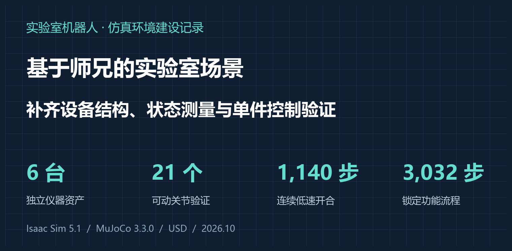
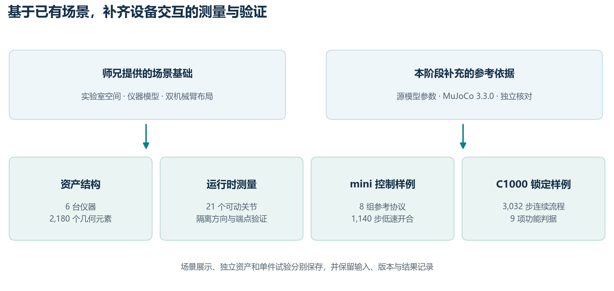
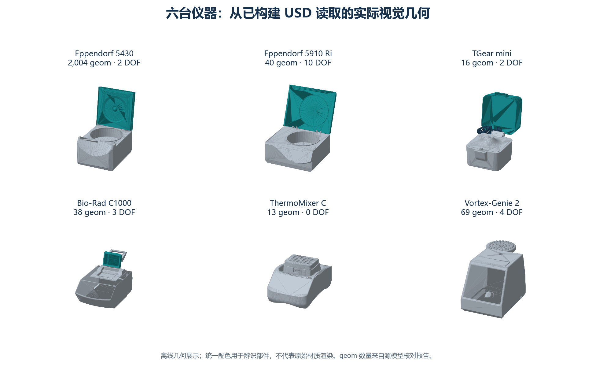
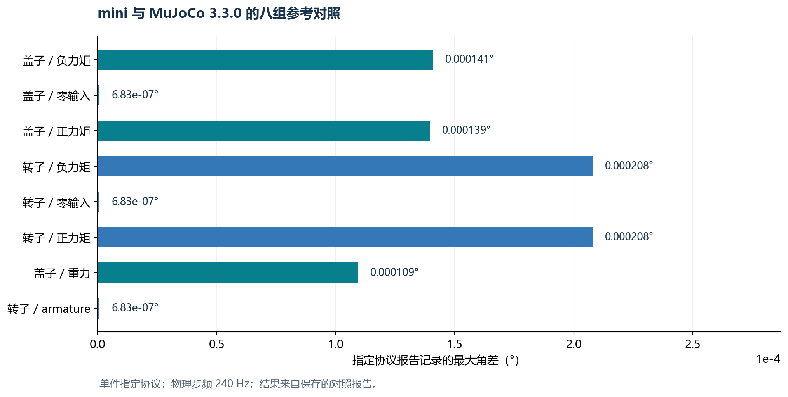
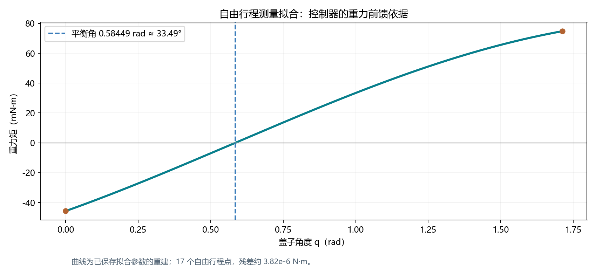
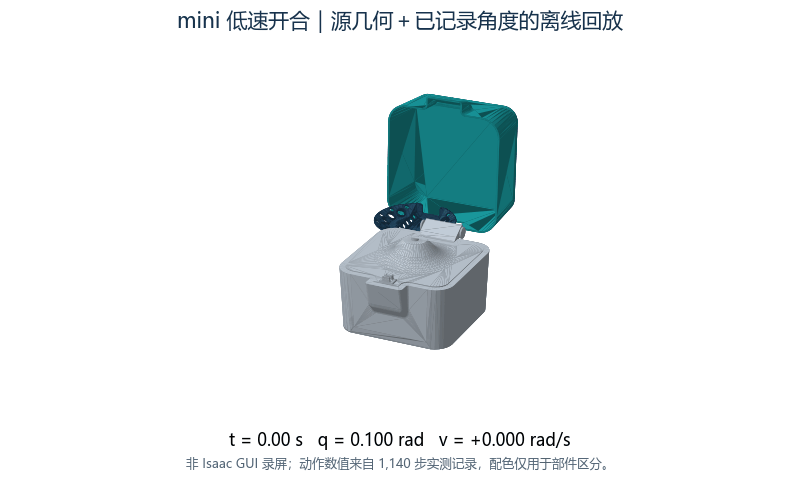
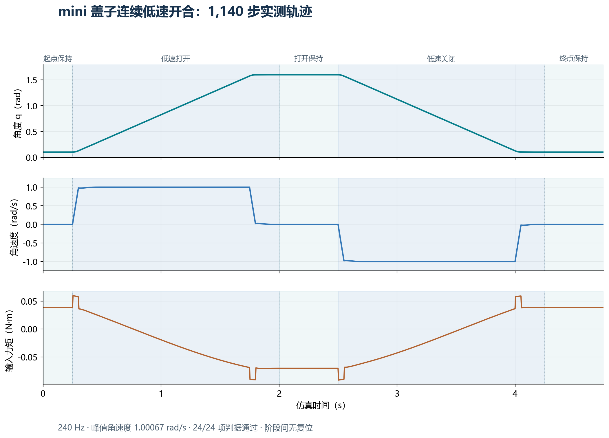

# 实验室机器人仿真建设笔记：基于师兄场景，完成六台仪器结构整理、21 个关节验证与单件交互控制



> 写在前面：这项工作基于师兄已有的实验室场景、设备资产与双机械臂布局继续开展。本文重点记录我在这一基础上补充的设备结构整理、物理状态测量、同源模型对照和单件交互控制。文中的场景展示、关节验证和设备控制分别对应各自的实验范围，便于后续按模块继续复用。

## 0. 结论先行：这一阶段具体做成了什么？

上一篇博客写的是 AutoBio 上的 VLA 微调与评测。这一阶段，我把工作向环境侧推进：围绕细胞培养实验室，在师兄的场景基础上，进一步建设能够承载设备操作研究的 Isaac Sim 工程。

**本阶段已经形成六台仪器的独立 USD 资产，完成 2,180 个源几何元素的结构核对和 21 个可动关节的分批隔离验证；围绕 mini 离心机，完成八组 MuJoCo 3.3.0 参考协议对照，以及 1,140 步连续低速开合；围绕 C1000 热循环仪，完成 3,032 步连续锁定功能试点。**

| 成果 | 实际结果 | 对后续工作的价值 |
| --- | --- | --- |
| 场景与机器人资源整理 | 保留原场景材质引用，接入本地双 UR5e 与 Robotiq 资源 | 提供本机查看实验室布局的入口 |
| 六台仪器独立资产 | 2,180 个源几何元素，21 个可动关节 | 设备可以分别构建、核对和测试 |
| 运行时测量链路 | 刚体位置与四元数、关节位置与速度均可读取 | 为动作判断提供直接观测量 |
| mini 同源参考对照 | 八组指定协议通过，报告最大角差约 0.000208° | 为选定协议提供动力学对照依据 |
| mini 连续低速开合 | 1,140 步，峰值角速度约 1.001 rad/s，24 项判据通过 | 获得可记录、可复跑的盖子控制样例 |
| C1000 独立锁定试点 | 3,032 步，9 项功能判据通过，三次功能轨迹一致 | 将锁定状态和物理约束共同纳入检查 |

这里最想强调三个点。第一，**新增工作沿着师兄的场景继续积累**，空间、设备和双机械臂布局都有明确的继承关系。第二，验证落实到具体设备、关节和实验协议，关键数字均有保存的记录对应。第三，工程产物同时包含资产、输入、状态轨迹和判据，可以在后续任务中继续使用。

## 1. 从师兄的场景继续：我补充了哪几层？

师兄已经提供实验室空间、实验台、仪器外观和双机械臂配置，这让本阶段可以直接围绕实验室操作推进。我进一步把工作分成场景、设备和试验三个层次。

**场景层**主要处理工程组织和资源引用。主场景保留实验室的整体空间关系，用于观察设备与机械臂布局；机械臂和夹爪的官方资源缓存到本地，场景继续使用原有材质引用。这样，后续检查布局时有统一的本机入口。

**设备层**以源模型为依据建立独立 USD。每台仪器保留自己的刚体、几何、关节和物理参数，便于单独加载与检查。设备独立资产与主场景分别保存，使设备验证能够集中在明确的对象上。

**试验层**规定输入、初态、物理设置和判据，记录推进前后的状态。一次试验结束后，可以回到保存的角度、速度、力矩和状态标记，检查结论是怎样得到的。



| 师兄提供的基础 | 我在此基础上的延续工作 |
| --- | --- |
| 实验室空间、台面与整体布局 | 梳理主场景、设备与资源的引用关系 |
| 已有仪器模型 | 按源模型建立独立资产、核对几何和关节坐标 |
| 双 UR5e 与夹爪配置 | 本地化官方依赖，保留主场景查看入口 |
| 实验室机器人操作方向 | 补充设备状态测量、定量协议与连续交互样例 |

本阶段主要环境为 Windows、Isaac Sim 5.1、RTX 4060 Laptop GPU，选定参考试验使用 MuJoCo 3.3.0。单件试验的物理设置随产物记录，其中 mini 低速开合采用 CPU 物理、真实重力和 240 Hz 步频。

## 2. 六台仪器：把设备结构整理为可独立检查的 USD

### 2.1 本轮资产覆盖

本轮覆盖三类离心机、热循环仪、恒温混匀仪和涡旋混匀仪。下图直接读取已构建 USD 中的视觉几何，采用统一配色展示部件结构，便于对照设备本体。



| 仪器 | 核对的源几何元素 | 可动关节 |
| --- | --- | --- |
| Eppendorf 5430 离心机 | 2,004 | 2 |
| Eppendorf 5910 Ri 离心机 | 40 | 10 |
| Tiangen TGear mini 离心机 | 16 | 2 |
| Bio-Rad C1000 热循环仪 | 38 | 3 |
| Eppendorf ThermoMixer C | 13 | 0 |
| Vortex-Genie 2 涡旋混匀仪 | 69 | 4 |
| **合计** | **2,180** | **21** |

这里的 geom 是源模型中的几何元素计数，包含模型组织所需的不同几何部件；它与设备台数、外观零件数分别统计。ThermoMixer C 在本轮源结构中没有可动关节，因此作为设备资产整理结果计入。

### 2.2 转换过程中具体保留了什么

转换按“几何—刚体—关节—物理参数”的顺序组织。几何层负责网格和局部变换；刚体层组织父子部件；关节层表达旋转或平移自由度、锚点、轴向和限位；物理参数层写入质量、质心及惯量等信息。

在 USD 中，可动连接使用正式的 `PhysicsRevoluteJoint` 或 `PhysicsPrismaticJoint`；质量相关数据通过 `MassAPI` 组织，驱动参数使用 `DriveAPI`。这使资产中的设备结构能够被物理运行时识别，也便于脚本按类型检查。

轴向与锚点核对采用共同世界坐标。具体做法是分别读取源模型和导出模型的局部坐标，再经过各自的父级变换，比较最终世界位置及方向。这样，检查覆盖了坐标系转换与父子变换关系。

独立核对报告中，最大锚点偏差约 **7.91×10⁻⁶ mm**，最大轴向向量误差约 **3.59×10⁻⁸**。这些数字表示数字资产转换与核对的一致程度，属于仿真模型内部的数值结果。

### 2.3 构建与核对分开保存

构建入口位于 `scripts/mjcf_instrument_to_usd_v5.py`，独立核对入口为 `scripts/check_v5_independent.py`，资产输出位于 `assets/instruments5/`。构建脚本负责生成资产，检查脚本重新读取产物并与源数据比较。保留两个入口后，资产更新时可以重复执行同一套核对。

## 3. 21 个关节：让设备动作能够被直接测量

设备交互需要明确的观测量。对盖子、转子这类绕轴运动的部件，我使用运行时姿态与关节坐标来判断动作。

刚体观测使用 `RigidBodyView.get_transforms()`，读取世界位置与四元数；关节观测通过 `ArticulationView` 读取关节位置和速度。旋转部件通过相对姿态或关节坐标判断角度，平移部件读取相应轴上的位移，同时记录锚点约束偏差。

这个选择与设备结构直接相关：如果铰链轴穿过刚体原点，部件转动时原点位置可以保持不变。角度变化需要由姿态或关节坐标反映。因此，后续开盖和转子试验都使用同一类状态读取方式。

### 3.1 验证协议

对每个可动关节，分批在隔离条件下设置初态、施加测试驱动、读取前后状态，检查运动方向和范围，并检查连接处约束。测试明确记录零重力、禁接触和注入测试驱动等设置，使方向验证与重力、接触造成的额外响应分开。

最终 **21/21 个可动关节完成该层级验证**，汇总保存在 `v5_runtime_acceptance_20261019.json`。这组结果用于证明关节结构、运行时读取与测试驱动之间的链路已接通，为后续带重力的单件试验提供基础。

### 3.2 保存哪些信息

每次验证记录设备名、关节名、初态、输入、末态和判据结果。对旋转关节，核心观测为角度与角速度；对连接约束，另外检查位置和禁止方向上的角度偏差。后续资产或控制代码变化时，可以用同一组字段继续检查。

## 4. mini 离心机：建立 MuJoCo 3.3.0 同源参考对照

在六台仪器中，我选择结构紧凑的 mini 离心机开展进一步试验。它包含底座、盖子和转子，适合分别考察盖子运动、转子响应以及重力作用。

### 4.1 八组协议如何组织

参考对照采用源模型的 MuJoCo 3.3.0 数据，覆盖盖子与转子的正向、反向和零输入响应，以及重力和指定 armature 条件。每组记录输入、初态、步频及物理配置，分别比较报告对应的状态。

八组指定协议均通过，报告中最大的角差约 **2.08×10⁻⁴°**。下面把各组差异分别画出，便于看到误差分布以及所覆盖的输入条件。



这项结果支持的是选定单件协议下的响应一致性。后续可以沿着同一输入、同一时间步和同一状态定义，继续扩展逐步轨迹对照。

### 4.2 测出盖子重力矩，为控制器提供依据

慢速开合需要考虑盖子在不同角度受到的重力矩。我使用自由行程内的测量点，拟合定轴转动形式：

```text
τg(q) = A·sin(q) + B·cos(q) + C
A =  0.0690607337 N·m
B = −0.0456426667 N·m
C = −0.0000405544 N·m
```

拟合使用 17 个自由行程点，残差约 **3.82×10⁻⁶ N·m**。包含常数项求得平衡角约 **0.58449 rad，即 33.49°**。曲线使控制器能够根据当前盖子角度计算重力补偿量。



该曲线也给出了直观解释：在平衡角两侧，重力分别使盖子趋向不同端点。悬空保持时，控制器需要持续提供与重力相反的力矩；保持段的实际输入可以与曲线相互核对。

## 5. mini 低速开合：连续 1,140 步记录动作全过程

### 5.1 动作效果与记录方式

这一试验按“起点保持—低速打开—打开保持—低速关闭—终点保持”的顺序连续运行。起终点为 **0.10 rad 与 1.60 rad**，均在限位内部。物理步频为 **240 Hz**，共记录 **1,140 步，约 4.75 秒**。

下面的动图使用实际 USD 视觉几何，并按照保存的关节角度重建动作，方便直观理解曲线对应的开合过程。



动图用于展示已记录运动；定量结果来自下方原始状态曲线和逐步文件。

### 5.2 控制器具体做了什么

控制器采用梯形运动参考，给出目标角度、速度和加速度；输入由惯性前馈、重力补偿及位置速度反馈组成：

```text
τ = I·a_ref − τg(q)
    + Kp·(q_ref − q) + Kd·(v_ref − v)
τ 最终限制在 [−0.25, +0.25] N·m
```

控制设计中，盖子惯量约 `1.05504×10⁻³ kg·m²`，设计带宽 `30 rad/s`，阻尼比 `0.7`。由 `Kp=Iω²` 和 `Kd=2Iζω` 得到增益约 `0.94953 N·m/rad`、`0.04431 N·m·s/rad`。设计速度为 `1 rad/s`，设计加速度为 `20 rad/s²`。

保持段使用常值位置参考，参考速度和加速度为零，反馈继续工作。规划器设置 `10⁻⁶ rad` 的位置死区，使很小的浮点差值进入保持逻辑。控制参数与拟合系数一起写入记录头，便于复算实际输入。

### 5.3 结果：速度、误差与输入一起检查



从上到下三条曲线分别表示角度、角速度和实际写入接口的力矩。打开与关闭段出现方向相反的速度平台，三个保持段速度接近零；打开保持时仍存在补偿力矩，与该角度下的重力作用相对应。

| 指标 | 本轮结果 |
| --- | --- |
| 连续物理步数 | 1,140 |
| 峰值角速度 | 1.00067 rad/s |
| 最大位置跟踪误差 | 1.667 mrad，约 0.096° |
| 力矩饱和步数 | 0 |
| 距限位的最小角度距离 | 约 0.10 rad |
| 运动及功能判据 | 24/24，通过 |

逐步记录包含 `q_pre`、`v_pre`、实际写入的 `torque_Nm`、`q_post` 和 `v_post`。步号从 0 连续到 1139，相邻步骤满足前一步的后状态与下一步的前状态一致，四处阶段边界同样连续。**这使“连续打开—保持—关闭”的结论能够通过状态记录直接复查。**

底层状态读取与写入力矩缓冲区使用 float32，JSON 按读数转记，不进行额外四舍五入。正文中的汇总数字保留便于阅读的小数位，复算使用逐步文件。

## 6. C1000 热循环仪：把锁定状态落实到连续物理流程

盖子控制之外，热循环仪还包含锁定状态。本阶段围绕 C1000 建立独立硬锁功能试点，将锁状态、误锁标记和盖子运动放到同一条连续流程中检查。

### 6.1 状态与动作如何连接

流程从初始锁定开始，先在锁定状态施加测试力矩，再明确解锁并打开盖子；随后在打开状态尝试锁定，记录误锁标记；继续回关，检查状态是否按协议保留；最后明确解锁、重新关盖并上锁，再次施加测试力矩。

```text
初始锁定 + 测试力矩
        ↓
解锁 → 开盖 → 打开状态尝试锁定
        ↓
记录误锁状态 → 回关 → 明确解锁
        ↓
关盖 → 再上锁 → 同样力矩下检查保持
```

试点用固定关节表达实体硬锁，操纵杆输入由测试夹具给定。它实现并检查的是这套硬锁方案的功能行为；源模型中的标量软等式约束另有自己的动力学含义，产物明确记录实现方式。

### 6.2 得到的结果

整段试验完成 **3,032 步连续流程，9 项功能判据通过**。两次最小物理应用运行与一次完整应用运行中，保存的关节状态及锁状态轨迹一致。运行中持续记录锁状态、误锁标记、盖子角度速度和约束误差，阶段切换保留盖子状态。

在选定的独立锁定对照中，锁定时施加 `+0.05 N·m` 持续 500 步，盖子保持锁定；解锁条件下出现对应的运动响应。功能检查因此同时覆盖状态切换和受力后的物理行为。

这项成果提供了一个可继续扩展的设备状态样例：后续任务可以读取明确的锁定状态，并通过物理响应验证状态是否生效。

## 7. 工程产物：从设备到记录都能找到对应入口

本阶段形成的内容按资产、试验与结果分开保存。日常查看使用主场景入口；设备结构检查使用独立资产；控制试验使用对应 runner 和记录文件。

```text
CellCultureLab/
├─ assets/
│  ├─ instruments5/             六台独立仪器资产
│  ├─ instruments6_pilot/       mini 物理试点资产
│  └─ scenes/                  独立测试场景
├─ scripts/                    构建、核对、测量与控制入口
├─ upstream/physics_reference/ 同源参考数据
├─ outputs/runtime_validation/ 状态轨迹与判据报告
└─ docs/                       验证口径与子任务覆盖矩阵
```

| 结果 | 对应记录或入口 |
| --- | --- |
| 六台仪器结构核对 | `outputs/runtime_validation/v5_independent.json` |
| 21 个关节隔离验证 | `outputs/runtime_validation/v5_runtime_acceptance_20261019.json` |
| mini 八组参考协议 | `outputs/runtime_validation/mini_articulation_330_comparison.json` |
| mini 低速控制汇总 | `outputs/runtime_validation/mini_lid_slow_real_cpu_rev2.json` |
| mini 完整逐步状态 | `outputs/runtime_validation/mini_lid_slow_real_cpu_rev2.steps.jsonl` |
| C1000 功能试点汇总 | `outputs/runtime_validation/c1000_isaac_lock_pilot/reviewed_summary.json` |
| 实验流程与模块对应关系 | `docs/细胞培养子任务覆盖矩阵.md` |

### 7.1 复查本文数字

在项目根目录，可直接读取已有报告复查结构结果，无需启动 GUI：

```powershell
$r = Get-Content outputs/runtime_validation/v5_independent.json -Raw | ConvertFrom-Json
$r | Select-Object passed, recognized_movable_joints

$m = Get-Content outputs/runtime_validation/mini_articulation_330_comparison.json -Raw | ConvertFrom-Json
$m.rows | Select-Object joint, passed, max_angle_error_deg
```

如需重新开展 mini 低速试验，现有入口支持以下配置。单独设置输出文件，便于保留已有结果：

```powershell
& D:\IsaacSim5\env\Scripts\python.exe scripts/run_mini_lid_task_v2.py `
  --sequence lid_slow --gravity real --mode cpu --record-steps full `
  --report outputs/runtime_validation/mini_lid_slow_meeting_rerun.json
```

本文图表基于已经保存的结果重建，整理文章时未重新启动物理仿真。图表数据来源单独保存在随文材料中，便于检查所引用的文件版本。

## 8. 这些成果如何衔接后续 VLA 工作？

从 VLA 的角度，设备状态、动作输入和任务条件需要有统一定义。本阶段把其中一部分落实到了可直接使用的模块：资产侧有明确的刚体与关节；观测侧有角度、速度和锁状态；动作侧有可追溯的输入；结果侧有连续轨迹和判据。

例如，后续组织开盖操作时，可以将盖子角度和速度作为设备状态，将目标开度及保持条件写入协议；组织热循环仪操作时，可以把锁状态作为任务条件的一部分。细胞培养子任务覆盖矩阵则将实验流程与已有设备、交互模块对应起来，帮助选择下一步具体任务单元。

本阶段得到的是**设备级结构与单件交互基础**。在此基础上，后续继续将机器人动作、设备状态和任务判据组合起来，逐个形成实验室操作单元。

## 9. 组会上可以怎样概括这段工作？

> 我这一阶段是在师兄已有的实验室场景和双机械臂布局上继续做设备交互建设。首先整理了六台仪器的独立 USD，核对 2,180 个源几何元素，接通运行时状态测量，并完成 21 个可动关节的隔离验证。然后选 mini 离心机做定量试验，完成八组 MuJoCo 3.3.0 参考协议对照，以及 1,140 步连续低速开合，峰值角速度约 1 rad/s、最大跟踪误差约 1.67 mrad。此外，C1000 热循环仪完成了 3,032 步连续硬锁功能试点。现在资产、测量、控制输入和结果记录都有对应入口，可以据此继续组织具体机器人操作任务。

上一篇：[AutoBio 复现笔记：单张 RTX 5090 + 5000 步 LoRA，实验室机器人成功率从 0% 做到 90%](https://blog.csdn.net/2301_77297031/article/details/167224240)
