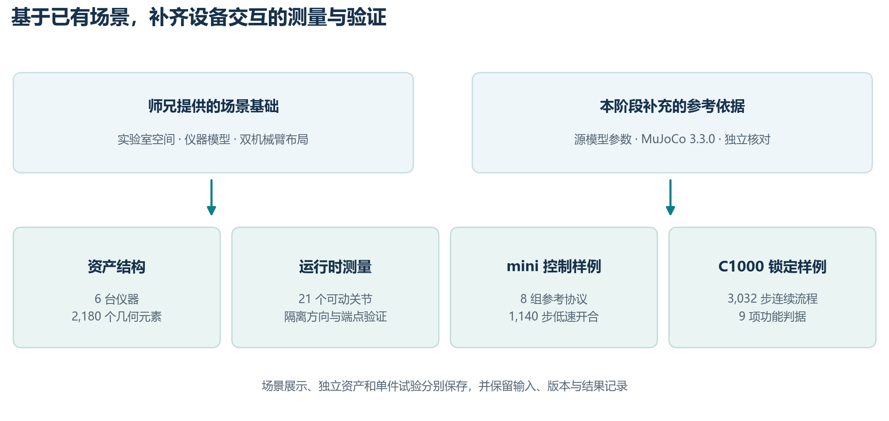
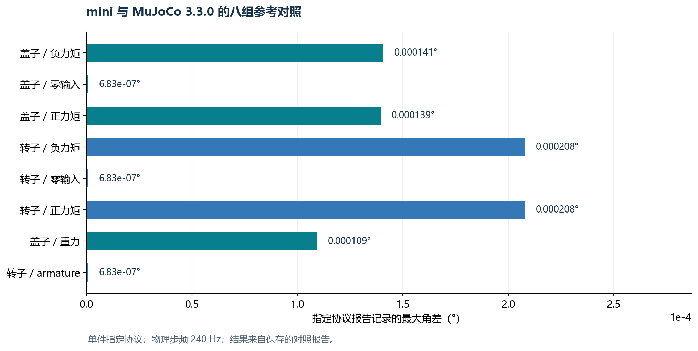
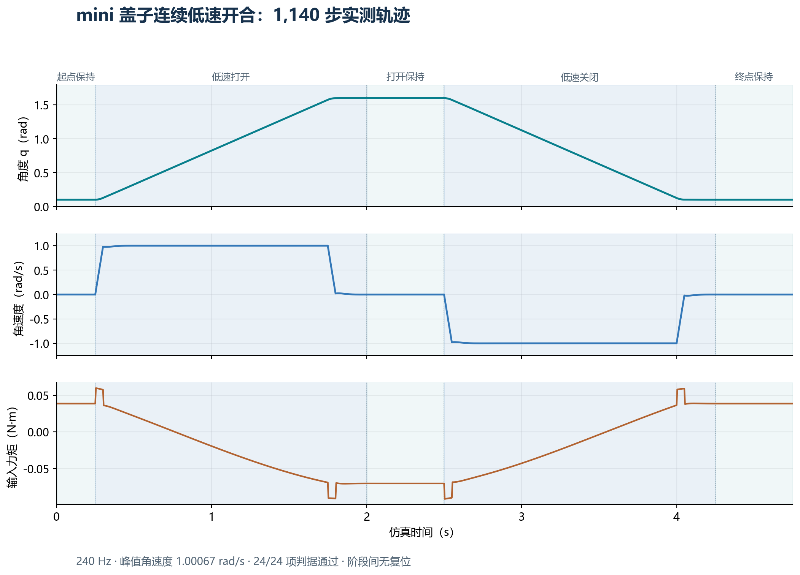

# 细胞培养实验室仿真建设记录：基于师兄场景，补齐六台仪器资产与关节级交互验证

## 0. 结论先行

上一篇博客记录了我在 AutoBio 上进行 VLA 微调与评测的工作。这一阶段，我继续围绕实验室机器人操作展开，把重点放在 **Isaac Sim 环境建设和设备交互验证** 上。

这次工作的起点是师兄提供的实验室场景、设备资产和双机械臂布局。在这一基础上，我主要补齐了资产组织、设备物理结构、运行时状态读取和单件仪器控制试验，形成了一套能够按设备、按关节复查的验证流程。

先把已经取得的阶段成果列出来：

| 工作内容 | 当前产出 | 验证层级 |
| --- | --- | --- |
| 继承并整理师兄的实验室工程 | 理顺场景与资产引用，接入本地双 UR5e 和夹爪资源，保留原场景材质 | 场景加载与显示 |
| 六台仪器的 USD 资产整理 | 对照源模型核对 2,180 个几何元素、21 个可动关节 | 独立资产结构与几何 |
| 运行时关节测量 | 接通刚体姿态、关节位置和速度读取，完成 21/21 个关节的分批隔离验证 | 零重力、禁接触、测试驱动 |
| mini 离心机参考对照 | 与 MuJoCo 3.3.0 的八组指定协议对照通过，记录中的最大角差约 0.000208° | 单件、指定动力学协议 |
| mini 盖子低速控制 | 1,140 步连续开合与保持，24 项判据通过；峰值角速度约 1.001 rad/s | 单件关节闭环 |
| C1000 锁定功能试点 | 3,032 步连续流程、9 项功能判据通过，同配置三次功能轨迹一致 | 独立硬锁功能试验 |

这一阶段的成果可以概括为：**在师兄已有场景的基础上，把设备资产进一步做成了有结构依据、能读取状态、能按协议验证的实验对象。**



## 1. 我承接了什么，又补充了什么

师兄的工作已经提供了很好的场景基础：实验室空间、实验台、仪器模型，以及双机械臂的布局。这些内容使我能够直接围绕具体实验室操作继续开展工作。

我在此基础上主要做了三个层面的补充。

**第一层是工程组织。** 理顺 `scenes`、`precision_tasks`、仪器资产和交互资产之间的目录关系，将实验室场景与被引用的设备分开管理；机械臂和夹爪使用本地官方资源，便于在当前机器上重复打开和检查。

**第二层是设备结构。** 以源模型中的几何、刚体和关节参数为依据，建立独立的 USD 仪器资产与测试场景。主场景用于检查空间与外观，独立场景用于集中验证某一台设备的关节和控制行为。

**第三层是测量与验证。** 将运行时读数、测试输入和判断条件放进脚本，输出逐步轨迹及 JSON 报告。这样，设备开了多少角度、转子如何响应、锁定状态是否生效，都有对应数据可以复查。

| 师兄提供的基础 | 本阶段的延续工作 |
| --- | --- |
| 实验室场景与空间布局 | 整理目录和引用关系，建立可在本机查看的完整场景入口 |
| 仪器外观与已有资产 | 补充独立资产构建、几何核对和关节结构检查 |
| 双机械臂及夹爪配置 | 本地化官方资源，恢复双机械臂的场景显示 |
| 实验室操作场景 | 按设备拆分试验，补充角度、速度、力矩及锁状态的量化记录 |

## 2. 六台仪器：建立统一的资产构建与核对流程

这一阶段整理的六台仪器分别是三种离心机、热循环仪、恒温混匀仪和涡旋混匀仪。

在独立资产库中，我以源模型导出的数据作为核对依据，对几何元素、刚体结构、关节轴、锚点和正式物理 Schema 逐项检查。

| 仪器 | 核对的几何元素数 | 可动关节数 |
| --- | ---: | ---: |
| Eppendorf 5430 离心机 | 2,004 | 2 |
| Eppendorf 5910 Ri 离心机 | 40 | 10 |
| Tiangen TGear mini 离心机 | 16 | 2 |
| Bio-Rad C1000 热循环仪 | 38 | 3 |
| Eppendorf 恒温混匀仪 | 13 | 0 |
| Genie 2 涡旋混匀仪 | 69 | 4 |
| **合计** | **2,180** | **21** |

这里的“几何元素”对应源模型的 `geom`，不等于可见零件数量，也不等于任务数量。恒温混匀仪在这份源模型中没有可动关节，其本轮成果是资产与物理参数整理。

结构处理主要包括：

- 使用正式的刚体、质量、关节与驱动 Schema 表达设备结构。
- 根据源模型的有符号轴向建立关节两侧的局部坐标系。
- 分别核对几何变换、关节锚点、旋转轴和端点约束。
- 将单件资产与宿主物理场景分开，便于在不同试验中复用。

在这份独立资产检查报告中，六台仪器全部通过核对；最大关节轴向残差约为 `3.59×10⁻⁸`，最大锚点残差约为 `7.91×10⁻⁶ mm`。这两个数反映的是模型转换和坐标核对的数值一致性。

对应的主要产物是独立仪器资产库、测试场景和 `v5_independent.json`。主场景与独立资产试验分别管理，各自承担清楚的验证职责。

## 3. 让设备状态可以直接测量

设备交互验证需要关节自身的状态读数。我接通了张量接口，通过 `RigidBodyView` 读取刚体的位置和四元数，通过 `ArticulationView` 读取关节位置与速度；对于独立关节测量，还结合关节两侧的局部坐标系计算相对运动。

这样可以分别记录：

- 转动关节的角度与方向；
- 滑动关节的位移；
- 刚体和关节锚点的约束误差；
- 指令前后的位置、速度及端点状态。

在 CPU、零重力、关闭接触并使用测试驱动的隔离条件下，我对 21 个可动关节分批完成了方向与端点约束验证。每个结果都能对应到当前资产哈希和测试报告。

这一步的产出是一个通用测量入口：后续做开盖、转动或其他设备动作时，可以直接复用同一套状态记录方法。**21/21 对应的是上述隔离条件下的关节级验证。**

## 4. mini 离心机：完成参考对照和连续低速开合

### 4.1 与原版本 MuJoCo 建立对照

我选择结构较清楚的 mini 离心机作为单件试点，使用独立的 MuJoCo 3.3.0 参考环境，对盖子和转子的八组指定协议进行比较。

试验采用实际 `240 Hz` 物理步频，覆盖正负力矩、零输入、重力及指定 armature 条件，并另外检查碰撞过滤控制。对照过程中保留试点资产，使用选定的同源参考数据。

八组协议全部通过，报告记录的最大角差约为 **0.000208°**。这为后续在同一件资产上开展控制试验提供了可复查的参考。



*图中每根柱表示对应协议报告记录的最大角差，单位为度。结果范围是这八组指定协议。*

### 4.2 建立带重力补偿的低速控制器

在参考对照基础上，我进一步完成了盖子的连续低速开合。控制器由三部分组成：

1. 梯形位置参考，给出期望位置、速度与加速度。
2. 重力与惯性前馈，根据测得的重力矩曲线和惯量计算基础力矩。
3. 位置与速度反馈，修正实际运动与参考轨迹之间的偏差。

控制结构可写成：

```text
控制力矩 = 惯性前馈 − 重力矩
         + Kp × 位置误差 + Kd × 速度误差
```

其中，重力矩采用自由行程采样拟合的形式：

```text
τg(q) = A sin(q) + B cos(q) + C
```

前馈模型、控制增益和限幅均保存在报告里。该试验使用设计速度 `1.0 rad/s`、设计加速度 `20 rad/s²`，力矩限幅为 `±0.25 N·m`。

连续流程为：**起点保持 → 低速打开 → 打开保持 → 低速关闭 → 终点保持**。起点和终点分别设置在 `0.10 rad` 与 `1.60 rad`，位于关节行程内部。

| 指标 | 实测结果 |
| --- | ---: |
| 物理步频 | 240 Hz |
| 连续记录步数 | 1,140 步 |
| 峰值角速度 | 1.00067 rad/s |
| 最大位置跟踪误差 | 1.667 mrad，约 0.096° |
| 力矩饱和步数 | 0 |
| 距两端限位的最小角度距离 | 约 0.100 rad |
| 功能及运动判据 | 24/24 通过 |



*曲线由 1,140 条逐步记录直接绘制，分别展示角度、角速度和实际写入的力矩。阴影区分五个连续阶段。*

记录中保存了每一步推进前后的状态，以及实际写入力矩接口的数值。相邻步骤的前后状态连续，阶段之间没有复位，因而能够复查整段“打开—保持—关闭”的过程。

这项结果的直接价值是：**得到了一份可以重复运行、可以量化检查的单件盖子控制样例。**

## 5. C1000 热循环仪：完成独立锁定功能试点

热循环仪的交互还包含锁定状态。因此，我在独立场景中，根据源逻辑组织了盖子与操纵杆之间的状态切换，并使用实体硬约束实现锁定功能试点。

连续试验覆盖以下行为：

- 初始锁住时承受测试力矩；
- 明确解锁后打开盖子；
- 在打开状态尝试锁定，记录误锁状态；
- 回关后保留相应状态；
- 明确解锁后清除误锁；
- 再次关盖、上锁，并在同样的测试力矩下保持锁定。

整段流程完成 **3,032 步**，**9 项功能判据全部通过**。在两次最小物理应用复跑和一次完整应用运行中，保存的功能轨迹一致，阶段之间没有重置盖子的位置或速度。

该试验同时记录锁状态、误锁标记和约束误差。由此，锁定行为能够通过状态与物理响应共同检查。

**这一节的成果是独立硬锁试点的功能验证。** 操纵杆输入由测试夹具给定，硬锁采用固定关节约束表达，报告将这一实现方式与功能结果一起保存。

此外，我建立了只加载必要物理依赖的运行入口。同一套 3,032 步功能试验，可以在较低开销的独立进程中复跑，便于后续持续检查设备行为。

## 6. 把阶段成果保存为可以继续使用的工程产物

除单项试验外，这一阶段还形成了几类可以继续复用的内容。

| 产物 | 用途 |
| --- | --- |
| 本地实验室查看入口 | 在原场景材质下检查实验室、双机械臂和设备布局 |
| 独立仪器资产与构建脚本 | 按源模型重新生成并检查设备结构 |
| 关节状态测量工具 | 记录位置、姿态、关节坐标与约束误差 |
| MuJoCo 3.3.0 参考数据 | 为指定单件协议提供同源对照 |
| mini 连续控制样例 | 复用轨迹规划、前馈、反馈和逐步记录方法 |
| C1000 锁定功能样例 | 复用锁状态切换与连续功能检查 |
| 子任务覆盖矩阵 | 将细胞培养流程对应到场景资产和验证模块 |

每次试验都尽量保存“输入、资产版本、逐步状态、判据、结果”这条完整记录。模型或脚本更新后，可以用相同协议重新检查，便于在现有工作上持续积累。

## 7. 下一阶段：围绕任务单元继续组织这些成果

目前已经形成了场景展示、独立资产、运行时测量和单件交互试验四个层面的产物。下一阶段，我会以这些模块为基础，围绕具体操作组织任务单元：将设备状态、机器人动作和任务判断条件放到统一流程中，再逐项开展验证。

对这次工作的定位是：**承接师兄提供的实验室场景，补齐一批能够复查、复跑和继续组合的设备交互基础，为后续实验室机器人任务与 VLA 数据工作提供实验模块。**

---

### 主要结果记录

- 六台仪器独立核对：`v5_independent.json`
- 21 个关节隔离验证汇总：`v5_runtime_acceptance_20261019.json`
- mini 八组参考协议：`mini_articulation_330_comparison.json`
- mini 低速开合：`mini_lid_slow_real_cpu_rev2.json` 及对应逐步记录
- C1000 连续锁定功能：`c1000_isaac_lock_pilot/reviewed_summary.json`

上一篇：[AutoBio 复现笔记：单张 RTX 5090 + 5000 步 LoRA，实验室机器人成功率从 0% 做到 90%](https://blog.csdn.net/2301_77297031/article/details/167224240)
